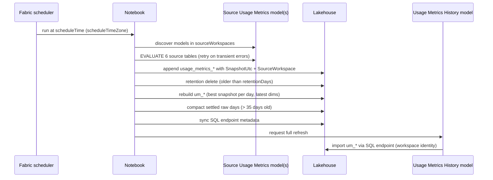

# Architecture

## Components

```mermaid
flowchart LR
    subgraph SRC["Source workspaces (one or many)"]
        UMR["Usage Metrics Report<br/>semantic model (built-in, ~30 days)"]
    end

    subgraph WS["WS-UsageMetrics (Fabric capacity)"]
        NB["NB_UsageMetricsHistory<br/>notebook, daily schedule"]
        subgraph LH["LH_UsageMetrics (Lakehouse)"]
            RAW["usage_metrics_*<br/>raw, append-only snapshots"]
            CUR["um_*<br/>curated, deduplicated"]
        end
        SQL["SQL analytics endpoint"]
        CONN["Cloud connection<br/>(workspace identity)"]
        SM["Usage Metrics History<br/>semantic model (Import)"]
        RPT["Usage Metrics History<br/>report"]
    end

    UMR -- "XMLA / DAX EVALUATE<br/>(semantic-link)" --> NB
    NB -- "append" --> RAW
    RAW -- "dedupe + retention" --> CUR
    CUR --> SQL
    SQL -- "Sql.Database" --> CONN --> SM
    NB -- "refresh trigger" --> SM
    SM --> RPT
```

## Daily flow

## Deployment flow (`deploy\Deploy.ps1`)

1. Create workspace and assign capacity.
2. Provision workspace identity.
3. Create lakehouse (SQL endpoint).
4. Publish notebook with config values and set the daily schedule.
5. Run notebook once to create the `um_*` tables.
6. Create the SQL connection (workspace identity) and grant the identity workspace access.
7. Clone the Usage Metrics model from `templateWorkspace`, swap the 6 data sources to the lakehouse, bind the connection, sync the SQL endpoint metadata, and refresh.
8. Clone the Usage Metrics report and bind it to the new model.

Re-running is idempotent: items are updated in place and the schedule is replaced.

## Data model

| Built-in model table | Raw table (append) | Curated table (model source) | Curation rule |
|---|---|---|---|
| Report views | usage_metrics_report_views | um_report_views | per workspace and day, the snapshot with most rows |
| Report page views | usage_metrics_report_page_views | um_report_page_views | same |
| Report load times | usage_metrics_report_load_times | um_report_load_times | same |
| Reports | usage_metrics_reports | um_reports | latest per ReportGuid (deleted reports keep their name) |
| Report pages | usage_metrics_report_pages | um_report_pages | latest per SectionId |
| Report rank | usage_metrics_report_rank | um_report_rank | latest per ReportId |

All other tables are unchanged:
- calculated tables: Users, Dates, Workspace views, Workspace reports;
- all 46 measures;
- relationships, auto date tables and translations.

`Dates` spans from the earliest stored day to today, so the visuals and slicers cover the full history automatically.

## Features

- **Same report and model as Microsoft's.** Both are cloned at deploy time from your own Usage Metrics Report, so they track Microsoft's current version. No Microsoft content is stored in this repo.
- **History beyond 30 days.** It is limited only by `retentionDays` (0 = forever).
- **Configurable schedule.** The daily `scheduleTime` is set in a `scheduleTimeZone` given as a Windows time zone id. The model refreshes right after the snapshot, so there is no timing gap.
- **Multiple workspaces.** Several source workspaces are unioned into one report. Empty `sourceWorkspaces` means auto-discover.
- **Accurate dedup.** Overlapping 30-day windows are resolved per day, choosing the most complete snapshot.
- **Stable users.** One UserId per UserKey across history, so a changed UPN doesn't break the `Users` lookup.
- **Privacy option.** With `exposeIdentity=false`, UserId and UserKey are stored SHA-256 hashed.
- **Bounded storage.** Raw days older than 35 days keep only the winning snapshot.
- **Resilient.** XMLA calls retry on transient errors. Hidden models are probed by name. The schema is appended with mergeSchema.
- **No stored secrets.** Model refresh uses a workspace-identity connection, and deployment uses your `az login`.
