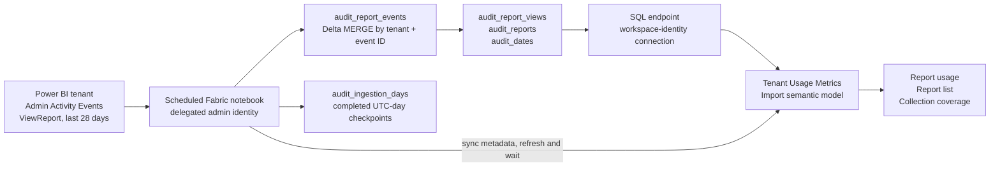

# Architecture

## Daily flow

1. Get a Power BI token for the notebook owner, who must have tenant Activity
   Events access. Do not confuse this identity with the model's SQL identity.
2. Select uncollected UTC days inside the retrievable window, plus `replayDays`
   of recently completed days. Bootstrap uses `backfillDays` (default 27).
3. Read every continuation token, including tokens on empty pages. Respect
   throttling, request budgets and bounded retries. Authentication failures stop.
4. Normalize report-open events and optionally hash user identifiers before
   storing them. IP addresses and arbitrary raw payloads are not retained.
5. MERGE pages into raw Delta by tenant/event ID. Partial runs are safe to retry;
   only a completely paginated day gets a completion checkpoint.
6. Remove rows older than the exact calendar-day retention cutoff. Logical
   deletion is not physical erasure from Delta transaction history/backups.
7. Build fact/dimension/calendar tables from all retained successful opens.
   Use stable report keys containing tenant, workspace and report identifiers.
   Names represent the latest observed metadata.
8. Fail explicitly on known historical collection gaps beyond the API horizon.
9. Sync SQL metadata and request a semantic-model refresh through REST. Wait
   for completion; failures propagate to the notebook run.

## Model and report

`Report views` is the fact table, related many-to-one to `Dates` and `Reports`.
Workspace/report slicers use the report dimension. `Collection` is a disconnected
coverage utility table, independent of report/date filters.

Measures include opens, distinct viewers, active reports/workspaces, dynamic
ranking and selected-period view trend. Trend compares equal-size first/last
halves of selected dates; an odd middle date is excluded.

No report-page-view, load-time or CU measures are invented. Activity Events
cannot provide those client-performance metrics. A report inventory with zero
opens is also outside this collector; report lists contain observed reports.

## Upgrade behavior

The managed notebook and report definitions are replaced on deployment.
Upgrades from the XMLA version use a new `Tenant Usage Metrics` semantic model,
because Fabric cannot change calculated partition types in place. The legacy
model remains; subsequent deployments update the managed tenant model.
The earlier XMLA raw/curated tables are not deleted and are never automatically
combined with audit data. New `audit_*` tables isolate the sources so the same
open is not double-counted.

## Operational requirements

The schedule owner must retain tenant admin API authorization. Capacity must
be active at run time. Alert on failed notebook jobs and inspect
`audit_ingestion_days` for coverage, not merely nonzero report counts.
The collector cannot reconstruct days that expired before collection began.
